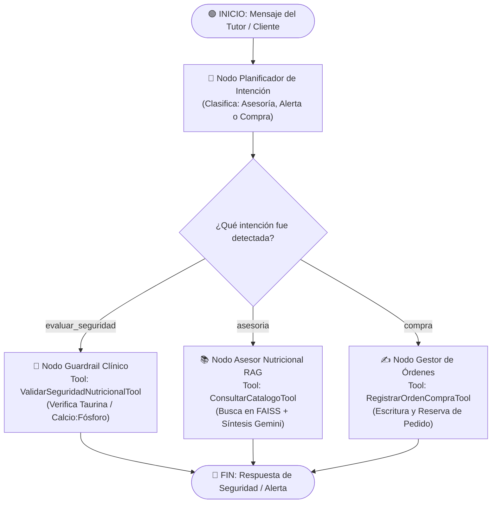

# 🐾 PetMind: Sistema Agéntico de Recomendación Nutricional y Gestión de Dietas Veterinarias

[](https://colab.research.google.com/)
[](https://opensource.org/licenses/MIT)
[](https://langchain-ai.github.io/langgraph/)
[](https://ai.google.dev/)

**Asignatura:** Ingeniería de Soluciones con IA (ISY0101)  
**Evaluación:** Evaluación Parcial N°2 — Encargo y Presentación (35%)  
**Organización:** NutriPet Catapilco (Zapallar, Región de Valparaíso)  
**Integrantes:** Gustavo Giha — Matias Morales  

---

## 📌 1. Resumen Ejecutivo y Caso de Uso

**PetMind** es un agente conversacional y transaccional inteligente diseñado para resolver la dependencia del conocimiento empírico en la tienda de alimentos para mascotas **NutriPet Catapilco**. 

A diferencia de un asistente conversacional genérico, **PetMind** implementa una arquitectura basada en **LangGraph** capaz de:
1. **Consultar:** Recuperación semántica RAG del catálogo oficial de alimentos caninos y felinos con composición analítica garantizada.
2. **Razonar:** Verificación de guardrails clínicos basados en protocolos veterinarios oficiales (VCA Animal Hospitals) para prevenir riesgos biológicos letales (ej. deficiencia de taurina en gatos o exceso de calcio en cachorros gigantes).
3. **Escribir:** Persistencia transaccional de órdenes de compra auditables con SKU, tutor y ficha técnica.
4. **Gestionar Memoria:** Memoria de corto plazo episódica (STM) para seguimiento conversacional y memoria de largo plazo vectorial (LTM con FAISS) para perfiles y literatura clínica.

---

## 🏗️ 2. Diagrama de Orquestación y Arquitectura del Agente

El siguiente diagrama modela el flujo determinista y adaptativo del estado (`EstadoPetMind`) dentro de **LangGraph**:



---

## 🛠️ 3. Estructura de Herramientas Tipadas (Pydantic v2)

| Herramienta | Tipo | Esquema Input | Descripción y Comportamiento |
| :--- | :---: | :--- | :--- |
| `consultar_catalogo_nutripet` | **Consulta** | `ConsultaCatalogoInput(query: str, k: int)` | Busca en la base vectorial FAISS los SKUs con mejor compatibilidad nutricional y física. |
| `validar_seguridad_nutricional` | **Razonamiento** | `ValidarSeguridadInput(especie, etapa, alimento_destinado)` | Evalúa contraindicaciones biológicas (ej. dar pellets caninos a felinos) bloqueando la recomendación errónea. |
| `registrar_orden_compra` | **Escritura** | `RegistroOrdenInput(cliente_nombre, sku, cantidad, mascota)` | Genera un ID de orden único y persiste la compra de forma auditable. |

---

## 📂 4. Estructura del Repositorio

```text
PetMind/
│
├── PetMind_Agente_NutriPet_ISY0101.ipynb   # Notebook principal para Google Colab
├── README.md                               # Documentación técnica y diagramas
├── requirements.txt                        # Dependencias de entorno
├── data/
│   ├── catalogo_nutripet.json              # Catálogo con 50+ SKUs y análisis garantizado
│   └── guias_clinicas.json                 # Protocolos clínicos de VCA Animal Hospitals
└── docs/
    └── informe_tecnico_EP2.md              # Informe de 5 páginas en formato académico
```

---

## 🚀 5. Instrucciones de Ejecución

### Opción A: Ejecutar en Google Colab (Recomendada)
1. Abre [Google Colab](https://colab.research.google.com/).
2. Haz clic en **Subir** (Upload) y selecciona el archivo [`PetMind_Agente_NutriPet_ISY0101.ipynb`](PetMind_Agente_NutriPet_ISY0101.ipynb).
3. En el menú lateral izquierdo, haz clic en el ícono de la **Llave (Secrets)** y agrega una variable llamada `GOOGLE_API_KEY` con tu clave de [Google AI Studio](https://aistudio.google.com/). Habilita el permiso de acceso para el notebook.
4. En el menú superior selecciona: **Entorno de ejecución > Ejecutar todas las celdas**.

### Opción B: Ejecución Local
```bash
# 1. Clonar el repositorio
git clone <url-del-repo>
cd PetMind

# 2. Crear entorno virtual
python -m venv venv
source venv/bin/activate  # En Windows: .\venv\Scripts\activate

# 3. Instalar dependencias
pip install -r requirements.txt

# 4. Configurar variable de entorno
export GOOGLE_API_KEY="tu-api-key" # En Windows PowerShell: $env:GOOGLE_API_KEY="tu-api-key"

# 5. Iniciar Jupyter Notebook
jupyter notebook PetMind_Agente_NutriPet_ISY0101.ipynb
```

---

## 🧪 6. Casos de Prueba Validados (Batería de Demostración)

1. **Cachorros Gigantes (Prevención de Osteocondritis):**
   - *Entrada:* "Tengo un cachorro Gran Danés de 3 meses. ¿Qué alimento le doy para cuidar sus huesos?"
   - *Comportamiento:* El agente activa `consultar_catalogo_nutripet`, recupera `NP-DOG-001`, y razona sobre el balance estricto de calcio y fósforo (1.2:1).
2. **Guardrail de Taurina (Riesgo Fisiológico Crítico):**
   - *Entrada:* "¿Puedo darle a mi gato la comida de mi perro para ahorrar presupuesto?"
   - *Comportamiento:* El planificador deriva a `validar_seguridad_nutricional`, detecta la deficiencia de taurina y emite alerta veterinaria inmediata bloqueando la venta.
3. **Escritura Transaccional:**
   - *Entrada:* "Quiero confirmar y ordenar una bolsa de comida para mi perro"
   - *Comportamiento:* Invoca `registrar_orden_compra`, genera un ID de orden auditable y persiste el estado de la compra.

---

## 📚 7. Referencias Bibliográficas (APA 7ma)
- Grant, C., Llera, R., & Buzhardt, L. (2024). *Nutritional requirements of large and giant breed puppies*. VCA Animal Hospitals.
- LangChain / LangGraph Documentation. (2026). *StateGraph and Multi-Agent Orchestration*. https://langchain-ai.github.io/langgraph/
- Weir, M., Llera, R., & Yuill, C. (2023). *Taurine in cats*. VCA Animal Hospitals.
