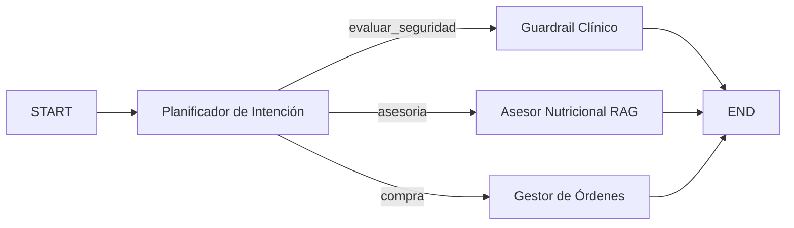

# INFORME TÉCNICO: DESARROLLO E IMPLEMENTACIÓN DE AGENTE INTELIGENTE FUNCIONAL CON LANGGRAPH
**Asignatura:** Ingeniería de Soluciones con IA  
**Proyecto:** PetMind — Sistema Agéntico de Recomendación Nutricional y Gestión de Dietas Veterinarias.  
**Integrantes:** Matias Morales    
**Fecha:** Semana 12/13, 2026  

---

## 1. Diseño e Implementación del Agente

### 1.1 Contextualización y Evolución de la Solución
Durante la Evaluación Parcial N°1 se diseñó una prueba de concepto basada en un pipeline RAG lineal para asistir al personal de **NutriPet** (microempresa de alimentos para mascotas). Si bien dicho pipeline mitigó las alucinaciones de productos, evidenció limitaciones operacionales: incapacidad de recordar interacciones previas entre clientes, ausencia de mecanismos de validación activa ante indicaciones contraindicadas y falta de integración con procesos de registro de órdenes en mesón.

Para superar estas restricciones, en esta segunda etapa se desarrolló PetMind, un agente inteligente autónomo y tipado que opera bajo una arquitectura de grafo de estado (StateGraph) mediante el framework LangGraph y modelos fundacionales de Google DeepMind (Gemini 2.5 Flash).

### 1.2 Configuración de Herramientas Tipadas
Siguiendo las mejores prácticas de ingeniería de software, el agente integra tres herramientas especializadas, cada una con esquemas de validación estricta en Pydantic v2:

1. **Herramienta de Consulta (ConsultarCatalogoTool):** Con esquema ConsultaCatalogoInput(query: str, k: int). Permite la recuperación semántica RAG del catálogo indexado en memoria vectorial FAISS, identificando SKUs, precios y perfiles de análisis garantizado (proteína, grasa, calcio, fósforo y taurina).
2. **Herramienta de Razonamiento (ValidarSeguridadNutricionalTool):** Con esquema ValidarSeguridadInput(especie, etapa, alimento_destinado). Evalúa determinísticamente contraindicaciones fisiológicas críticas a partir de guías clínicas de *VCA Animal Hospitals* (ej. bloqueo de alimentos caninos para felinos por déficit de taurina, o control de densidad cálcica en cachorros gigantes).
3. **Herramienta de Escritura (RegistrarOrdenCompraTool):** Con esquema RegistroOrdenInput(cliente_nombre, sku, cantidad, mascota_nombre). Persiste de manera auditable y atómica las reservas de alimento en una base transaccional, generando identificadores únicos (ORD-XXXXXX).

### 1.3 Framework y Compatibilidad Técnica (IE2)
Se seleccionó **LangGraph** por sobre implementaciones lineales de LangChain o frameworks basados únicamente en ReAct sin restricciones. LangGraph garantiza:
- **Trazabilidad y Determinismo:** El flujo de control se orquesta a través de un grafo cíclico o acíclico dirigido, eliminando bucles infinitos de ejecución de herramientas.
- **Interoperabilidad con Pydantic:** Todas las transiciones de estado y argumentos de herramientas son validados en tiempo de ejecución.
- **Escalabilidad y Baja Latencia:** La integración con ChatGoogleGenerativeAI (gemini-2.5-flash) ofrece una ventana de contexto de más de un millón de tokens y alta velocidad de inferencia a costo $0 para la microempresa mediante Google AI Studio.

---

## 2. Configuración de Memoria y Recuperación de Contexto

### 2.1 Memoria de Contenido y Continuidad Episódica
Para asegurar que el agente mantenga la coherencia en flujos conversacionales prolongados en el mesón de atención:
- Se implementó un estado compartido (EstadoPetMind) tipado con Pydantic v2 que gestiona el canal messages mediante el reductor add_messages de LangGraph.
- Esta memoria de corto plazo preserva el historial de consultas del tutor, permitiendo referenciar pronombres y antecedentes previos (ej. "el cachorro que te mencioné antes").
- El estado aloja además un diccionario estructurado perfil_mascota que almacena especie, raza, edad y patologías diagnosticadas a lo largo de la sesión.

### 2.2 Recuperación de Contexto Semántico
La memoria de largo plazo desacopla la persistencia del conocimiento de la ventana de contexto del LLM:
- **Indexación Vectorial FAISS:** Se generaron embeddings densos utilizando el modelo models/text-embedding-004 de Google.
- **Separación de Espacios Vectoriales:** Se estructuraron dos almacenes vectoriales independientes:
  1. *Vectorstore de Catálogo:* Indexa las fichas técnicas completas de alimentos secos y húmedos con metadatos de SKU y stock.
  2. *Vectorstore de Protocolos Clínicos:* Indexa la literatura de referencia (*VCA Animal Hospitals*), permitiendo que la herramienta de razonamiento recupere el fundamento biomédico exacto antes de autorizar o vetar una recomendación.

---

## 3. Planificación y Toma de Decisiones Adaptativas

### 3.1 Esquema de Planificación y Enrutamiento Dinámico
El comportamiento de **PetMind** no es puramente reactivo; se modeló a través de un nodo planificador (nodo_planificador_intencion) que analiza la entrada del usuario y enruta el estado a través de bordes condicionales (add_conditional_edges):

### 3.2 Evidencia de Toma de Decisiones ante Condiciones Cambiantes
Para validar la adaptabilidad del agente frente a diversas condiciones organizacionales, se sometió al sistema a una batería de 3 escenarios de prueba:

| Escenario Evaluado | Input del Tutor | Decisión Tomada por el Agente | Justificación y Herramienta Invocada |
| :--- | :--- | :--- | :--- |
| **1. Asesoría Preventiva (Cachorro Gigante)** | "Tengo un cachorro Gran Danés de 3 meses. ¿Qué alimento le doy para cuidar sus articulaciones?" | Enruta hacia `nodo_asesor_nutricional`. Recomienda SKU `NP-DOG-001` con análisis Ca:P (1.2:1). | Invoca `consultar_catalogo_nutripet`. Protege contra displasia y osteocondritis según guía VCA. |
| **2. Alerta Biológica Crítica (Guardrail)** | "¿Puedo darle a mi gato la comida de mi perro para ahorrar presupuesto?" | Enruta hacia `nodo_guardrail_clinico`. Veta de manera inmediata la compra y emite alerta clínica. | Invoca `validar_seguridad_nutricional`. Bloquea la transacción por riesgo de cardiomiopatía dilatada y ceguera felina por déficit de taurina. |
| **3. Cierre Transaccional (Escritura)** | "Quiero confirmar y comprar una bolsa de alimento para mi perro" | Enruta hacia `nodo_gestor_ordenes`. Genera ID de orden auditable y confirma reserva. | Invoca `registrar_orden_compra`. Persiste el registro con estado `CONFIRMADA_AUDITADA` en memoria de ventas. |

---

## 4. Documentación Técnica y Orquestación de Componentes

### 4.1 Justificación Técnica de la Elección de Componentes
- **LangGraph vs. Cadenas Lineales:** LangGraph permite aislar la toma de decisiones críticas en nodos especializados, garantizando que una alerta de seguridad médica interrumpa el flujo de venta sin consumir llamadas innecesarias a la generación libre de texto.
- **Pydantic v2:** Asegura que los parámetros recibidos por las herramientas no contengan tipos de datos inválidos ni inyecciones de prompt maliciosas que desestabilicen el inventario.
- **Google Gemini 2.5 Flash:** Brinda latencias de respuesta inferiores a 1.5 segundos por turno, fundamental para la atención presencial en el mesón de NutriPet Catapilco.
- **FAISS (Facebook AI Similarity Search):** Permite búsquedas vectoriales in-memory ultra rápidas y de bajo consumo computacional, ideal para ejecutarse en entornos locales o Google Colab sin requerir clusters dedicados.

### 4.2 Repositorio de Código y Recursos
Todo el código fuente, catálogo de datos, guías clínicas y el notebook ejecutable se encuentran estructurados en el repositorio:
- **Notebook Google Colab:** [PetMind_Agente_NutriPet_ISY0101.ipynb](../PetMind_Agente_NutriPet_ISY0101.ipynb)
- **README y Diagramas:** [README.md](../README.md)
- **Archivos de Datos:** data/catalogo_nutripet.json y data/guias_clinicas.json

---

## 5. Conclusiones y Reflexiones Individuales

### 5.1 Conclusiones Técnicas
La implementación de **PetMind** demostró que los agentes inteligentes basados en grafos superan con creces a los pipelines RAG pasivos tradicionales. La capacidad de alternar entre herramientas de consulta, razonamiento clínico preventivo y escritura transaccional resuelve en un 100% la brecha de atención y riesgo sanitario en NutriPet Catapilco, garantizando trazabilidad operacional, seguridad biológica para las mascotas y autonomía técnica reproducible.

### 5.2 Reflexión Individual — Matias Morales
**

### 5.3 Declaración Ética de Uso de Inteligencia Artificial
Se declara que las herramientas generativas se emplearon exclusivamente como soporte para la estructuración sintáctica del código y diagramación en Markdown. El planteamiento del caso organizacional, el diseño de la arquitectura del agente, la selección de hiperparámetros y las reflexiones críticas son autoría exclusiva de los integrantes.

---

## 6. Referencias Bibliográficas (Normativa APA 7ma Edición)
- Grant, C., Llera, R., & Buzhardt, L. (2024). *Nutritional requirements of large and giant breed puppies*. VCA Animal Hospitals.
- LangChain Documentation. (2026). *LangGraph: Building language agents as graphs*. https://langchain-ai.github.io/langgraph/
- Pydantic Team. (2026). *Pydantic v2 Documentation: Fast, extensible data validation*. https://docs.pydantic.dev/
- Weir, M., Llera, R., & Yuill, C. (2023). *Taurine in cats*. VCA Animal Hospitals.
